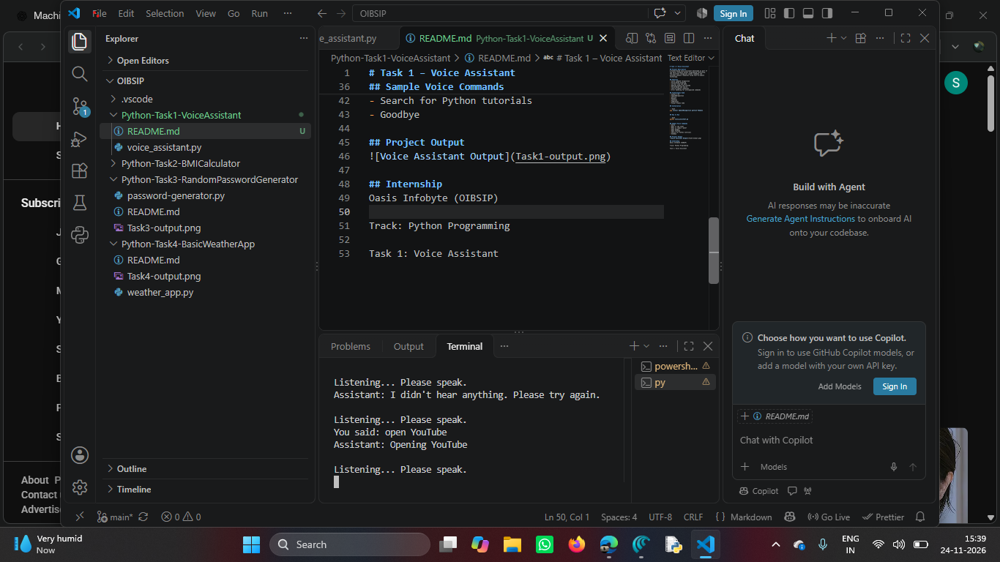

# Task 1 – Voice Assistant

## Project Description
A Python-based voice assistant developed as part of the Oasis Infobyte Python Programming Internship. The assistant recognizes spoken commands and provides audible responses using text-to-speech technology.

## Features
- Voice command recognition
- Voice-based greeting
- Current time and date
- Opening Google and YouTube
- Voice-based web search
- Text-to-speech responses
- Error handling for unrecognized commands

## Technologies Used
- Python 3.12
- SpeechRecognition
- pyttsx3
- PyAudio
- datetime
- webbrowser
- Visual Studio Code

## Installation

```bash
pip install SpeechRecognition pyttsx3 PyAudio
```

## How to Run

```bash
python voice_assistant.py
```

## Sample Voice Commands
- Hello
- What is the time?
- What is today's date?
- Open Google
- Open YouTube
- Search for Python tutorials
- Goodbye

## Project Output


## Internship
Oasis Infobyte (OIBSIP)

Track: Python Programming

Task 1: Voice Assistant